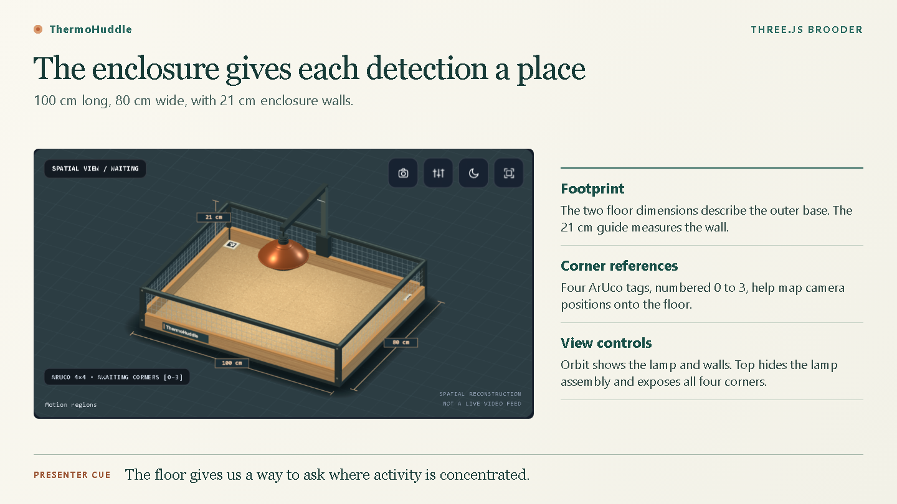
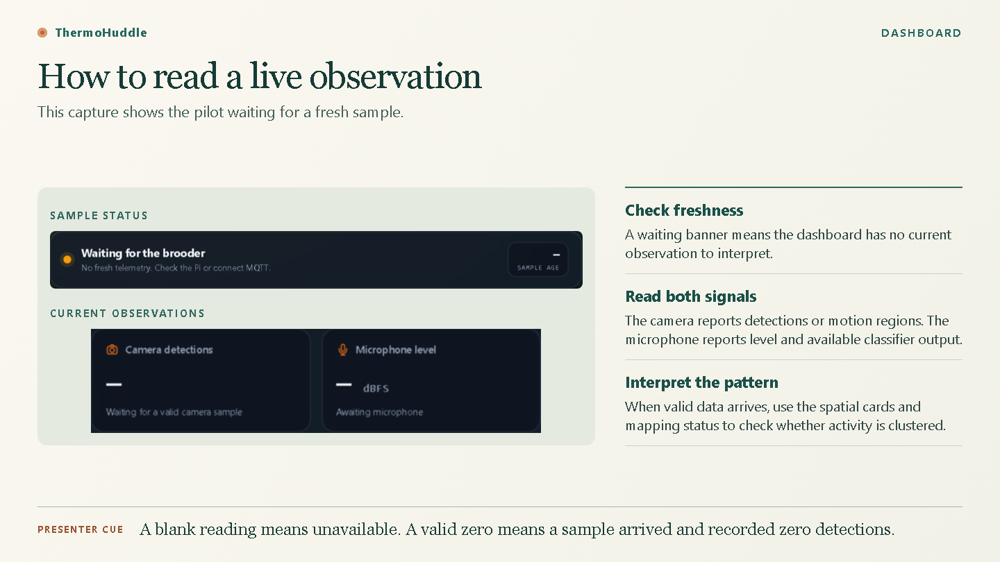
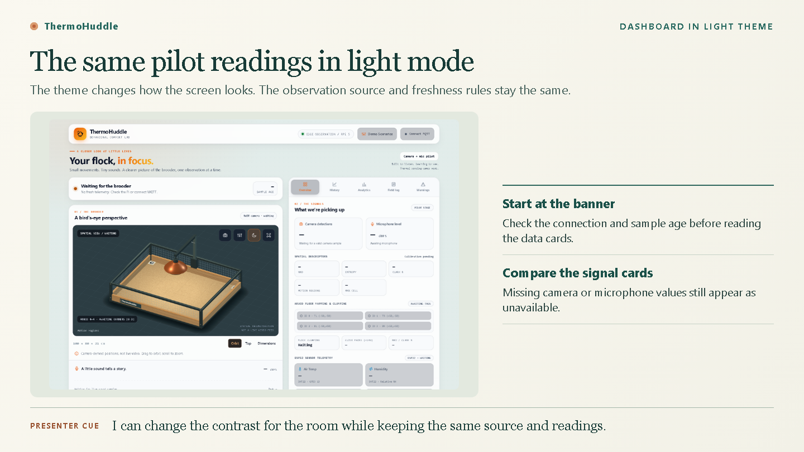
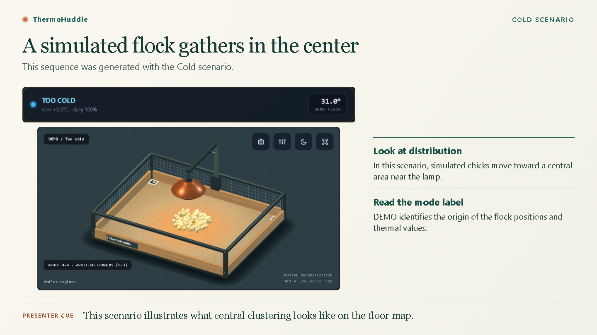
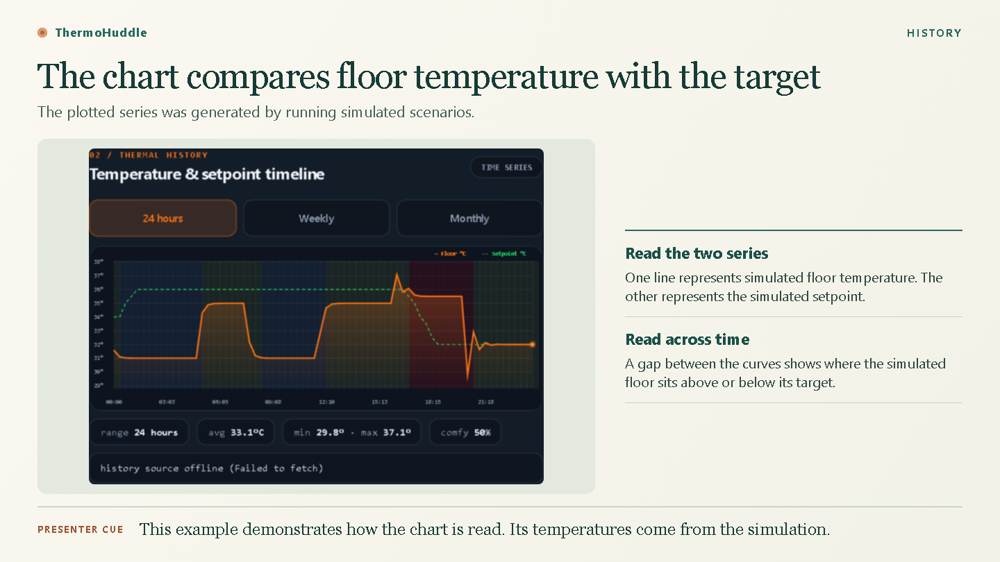
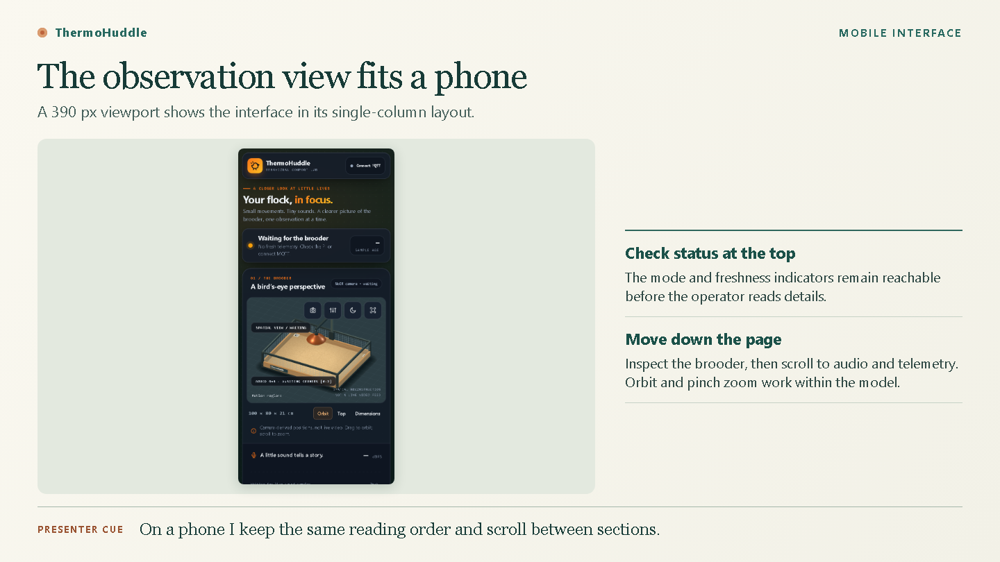
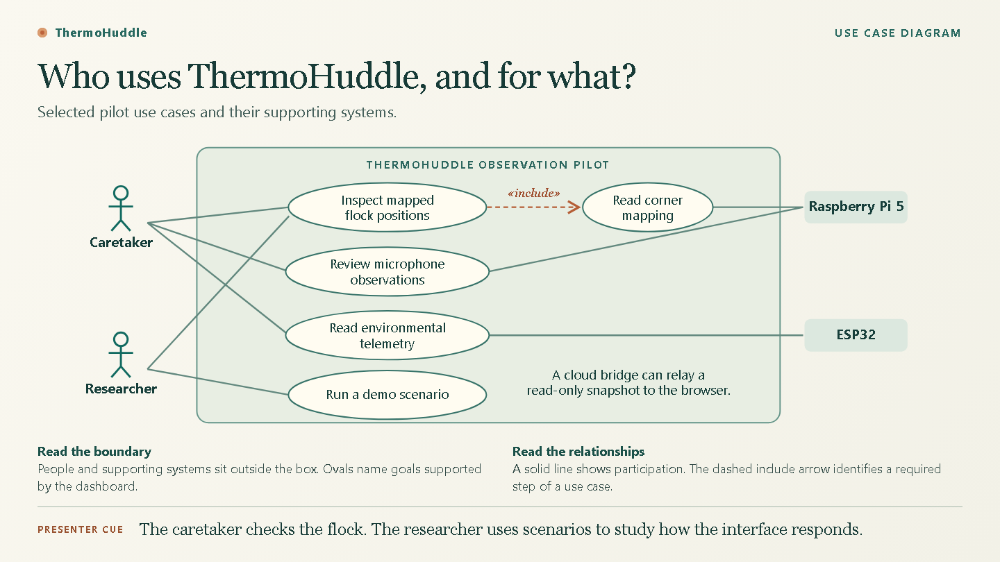
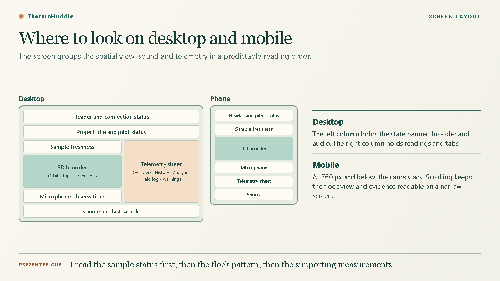

# ThermoHuddle 🐤

**Edge AI smart brooder** — observes how day-old chicks *distribute themselves* across the floor, fuses spatial behavior with vocalization and environmental telemetry, and gently trims the heat lamp around an age-based schedule instead of trusting a single point-source air thermostat.

> **Live Web App (No Install Required):** **https://tanjames121.github.io/thermohuddle/**
> Installable as a Progressive Web App (PWA) on desktop, Android, and iOS.

Team: **Bolda · Gabriel · Payumo · Tan · Tangcuangco** — CpE 404 Capstone Design 1

---

## Visual Showcase — Bento Glassmorphic Dashboard & Diagrams

[Present the five-figure walkthrough](https://tanjames121.github.io/thermohuddle/docs/presentation/) · [Read the speaker script and panel questions](docs/presentation/README.md)

### Three.js brooder

The model has a 100 × 80 cm outer footprint and 21 cm enclosure walls. **Orbit** shows the lamp assembly, **Top** exposes the full floor, and **Dimensions** shows measurements. Drag to orbit and pinch or scroll to zoom.

### Live Observation Dashboard (Obsidian Dark & Warm Light)

| Live Pilot · Obsidian Dark Bento | Live Pilot · Warm Light Bento |
|---|---|
|  |  |

### Behavioral Modes, Thermal History & Mobile Responsive Layout

| Simulated Cold Scenario | Thermal History Timeline | Mobile Stack (390 px) |
|---|---|---|
|  |  |  |

### System Architecture & UI/UX Blueprints

| UML Use Case Diagram | Bento Screen Layout Blueprint |
|---|---|
|  |  |

---

## Quick Start & Desktop Launcher

### Option 1 — Hosted PWA (Zero Setup)
Open **https://tanjames121.github.io/thermohuddle/** on any phone or PC:
- **GitHub Pages LIVE:** boots in observation mode and automatically polls the public read-only HTTPS camera/microphone snapshot every 2 seconds while the tab is visible. No MQTT password or connect click is required; new readings appear at the Pi pipeline cadence (~10 s), and hidden tabs pause requests.

### Option 2 — Raspberry Pi Desktop Executable (On-Demand Launch)
ThermoHuddle background services are configured **not** to auto-start on boot. Launch on demand from the Desktop icon **`ThermoHuddle.desktop`** (which starts the local server + pipeline and opens `http://localhost:8422/index.html`):
- **Default click:** Start dashboard + AI observer + cloud bridge and open the browser.
- **Right-click → Open Dashboard Only:** Start only the HTTP dashboard (`:8422`).
- **Right-click → Stop ThermoHuddle Background Services:** Stop all ThermoHuddle user services cleanly.

Or launch manually from the repository root:
- **Linux / Raspberry Pi / macOS:** `bash start_app.sh` → `http://localhost:8422/index.html`
- **Windows:** double-click `start_app.bat`

---

## Pilot Truthfulness & Safety Boundaries

- **Local LIVE:** MQTT remains available through private, git-ignored `broker.js`; same-origin Pi JSON (`tracking_latest.json`) is the fallback. Never commit publisher credentials to a public repository.
- **Camera view:** a Three.js spatial reconstruction of the 100 × 80 × 21 cm enclosure of detected positions / motion regions (`ArUco 4x4` floor homography IDs `0–3`), not live video or a validated chick count. Live video requires a separately configured stream.
- **Camera/mic pilot:** when floor DS18B20 and thermal actuators are not connected, thermal controls, thermal history/CSV export, and comfort claims remain unavailable in LIVE mode. Scenario controls (`Comfy`, `Cold`, `Hot`, `Draft`, `Crowding`, `Lamp fail`, `NH₃ spike`) explicitly use simulated data.
- **Panels:** `Overview`, `History`, `Analytics`, `Field log`, and `Warnings`. The Pi and its cloud bridge must stay running for fresh remote observations.

---

## Repo Layout

| Path | Purpose |
|---|---|
| `index.html`, `brooder.css`, `pilot.js`, `cloud-feed.js` | **The PWA** — Bento glassmorphic 3D dashboard, honest pilot state validation, MQTT-over-WS, and HTTPS cloud polling |
| `manifest.json`, `sw.js`, `vendor/three/`, `p5.min.js`, `mqtt.min.js`, icons | Offline PWA shell + bundled local WebGL/MQTT libraries |
| `start_app.bat` / `start_app.sh` | One-click local launchers |
| `broker.js.example`, `mosquitto.conf.example` | Broker credentials/config templates (keep real `broker.js` out of git) |
| **`docs/ThermoHuddle_Overview.md`** | **Project overview & feature manual** — comfort states, spatial statistics (NND/Shannon/Clark–Evans), and data model |
| **`docs/ThermoHuddle_Build_Guide.md`** | **Build & deployment guide** — Supabase SQL setup, Pi services, 16-week roadmap, troubleshooting |
| `docs/design/` & `docs/presentation/` | Bento UI/UX design notes, browser verification records, use-case & screen-layout diagrams, and presentation screenshots |
| `pipeline/` | Pi edge pipeline: `ai_observer.py`, `chicken_vision.py`, `chicken_audio.py`, `esp32_sensor_bridge.py`, `cloud_snapshot_bridge.py`, `thermohuddle_draft_v2.py`, `test_broker_ws.py` |
| `tests/` | Offline Node (`tests/model-pilot-checks.js`), browser checks (`pilot-checks.js`, `pilot-ui-checks.js`, `cloud-feed-checks.js`, `pilot-regressions.js`), and Python `pytest` suite |

---

## Public Camera/Microphone Uplink

`pipeline/cloud_snapshot_bridge.py` reads the running Pi pipeline snapshot and uploads only allowlisted positions, count, camera availability, microphone measurements, and ESP32 read-only telemetry. The public object is overwritten, not appended; source timestamps remain unchanged so old samples are never relabeled as fresh.

Check the user service when running on demand: `systemctl --user status thermohuddle-cloud.service`. Both the bridge and `thermohuddle-ai.service` must be running for fresh remote observations. No raw microphone audio, camera video, or write credentials are ever uploaded.

---

## Safety-First Cascade Architecture

Five isolated services on the Raspberry Pi 5: `th-sensord` (safety-critical control, zero AI imports) · `th-visiond` · `th-audiod` · `th-brain` (cross-modal fusion + bounded trim) · `th-uplink` (MQTT/SQLite/Supabase).

The classifier never drives the heater directly — it only adjusts a **±2 °C** trim on the age-based baseline (`34 → 29 °C` over 14 days), with a 10-minute dwell, `1 °C/h` rate limit, and fan blanking. Crowding (`>45%` max-cell fraction) is a deterministic rule outside the model with human acknowledgement, backed by a **KSD301 hardware over-temp cutoff**.

Full details: **[`docs/ThermoHuddle_Overview.md`](docs/ThermoHuddle_Overview.md)** + **[`docs/ThermoHuddle_Build_Guide.md`](docs/ThermoHuddle_Build_Guide.md)**.
