# ThermoHuddle presentation guide

[Open the presentation](https://tanjames121.github.io/thermohuddle/docs/presentation/) · [Open the interactive brooder](https://tanjames121.github.io/thermohuddle/)

The five main figures form a roughly five-minute talk (578 spoken words). Each has a visual cue, an explanation for rehearsal and a script you can read aloud. The six additional figures are available for a longer demonstration or panel questions.

## Three.js brooder

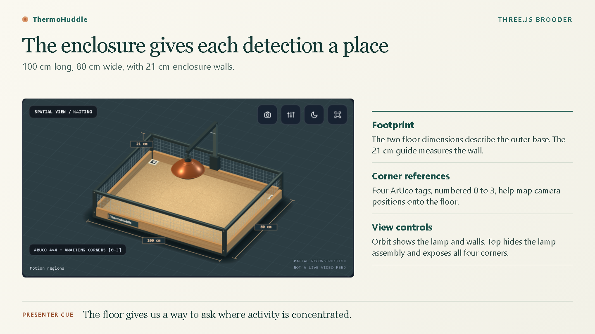

**What it shows**

The Three.js scene uses centimetres. The lamp is mounted above the enclosure, so its height is separate from the wall measurement. The pilot and renderer share a tracking coordinate system. When the camera sees the four floor markers, a perspective mapping lets the interface place detections relative to those corners. Without a valid mapping, interpret positions as approximate. The wood, mesh, bedding and lamp assembly illustrate the proposed enclosure.

**What to point at**

Trace the 100 and 80 cm guides. Point to the 21 cm wall and then to a corner marker. If the live page is open, select Top.

**Speaking script**

> Good day. I’ll start with the brooder itself, because the rest of the interface is easier to understand once we know what the camera is looking at. The base is one meter long and eighty centimeters wide. This short vertical line measures the wall. We modeled it at twenty-one centimeters, the midpoint of our twenty-to-twenty-two-centimeter range. The lamp sits above it. Now look at the black-and-white squares in the corners. The camera can use those four known points to map an angled image onto a flat floor. If we switch to Top, we can see whether detections are spread out or concentrated in one part of the enclosure. That brings us to the controls the presenter or caretaker actually uses.

## User interface

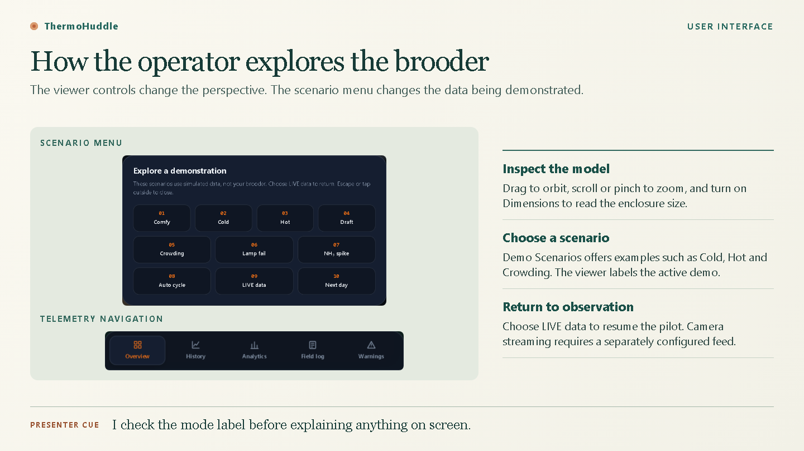

**What it shows**

The user interface is the set of actions a person can take. The scenario palette is useful during a defense because it lets the audience see a repeatable example even when the Pi has no fresh sample. The camera button opens a separately configured stream. The theme toggle changes contrast, and the snapshot control exports the current 3D view as a PNG.

**What to point at**

Point to the scenario menu. In a live walkthrough, choose Cold, show the DEMO label, then choose LIVE data.

**Speaking script**

> Here is how I would use the interface during a demonstration. First I can drag the model to inspect a wall, or choose Top to see the whole floor. Those controls only change my view. Next I can open Demo Scenarios and choose Cold. The mode label changes to DEMO, and the simulated chicks move toward the center. That lets everyone see the same example even if our Pi is offline. When I choose LIVE data again, the dashboard goes back to reporting what the pilot has actually received. That label matters because a convincing animation can otherwise be easy to mistake for an observation.

## Use case diagram

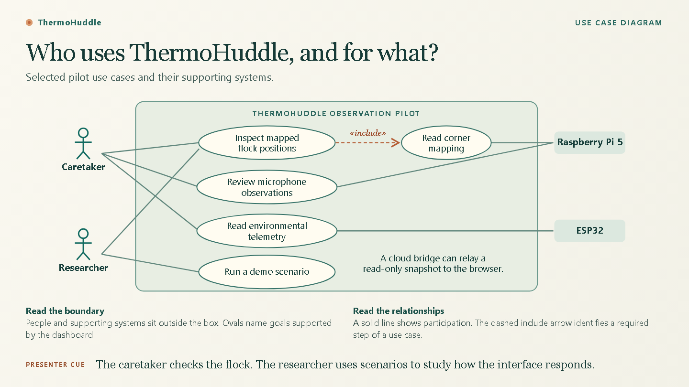

**What it shows**

A use case diagram organizes goals by actor. It does not set the chronological order of operations. The redrawn diagram focuses on the current observation pilot. The full design also associates the caretaker with environmental readings and hazards, and the researcher with history and evaluation. The Pi processes camera and microphone input, the ESP32 can supply sensor readings, and a cloud bridge can relay a limited snapshot. The broader design includes bounded thermal adjustment and independent safety checks. Those belong to the proposed control system.

**What to point at**

Start at the caretaker and follow the association to Inspect mapped positions. Then follow the dashed arrow to Read corner mapping. Finish at the researcher.

**Speaking script**

> This diagram answers a different question. Who needs the system, and what are they trying to do? Start on the left with the poultry caretaker. One goal is to inspect where activity falls on the brooder floor. Follow the dashed arrow from that goal. To interpret a mapped position, we first need to know the status of the corner mapping. The caretaker can also review microphone observations and any available environmental readings. The second person is the capstone researcher, who can run scenarios to compare how the interface presents different flock patterns. On the right, the Raspberry Pi and ESP32 supply observations, and the cloud bridge supports remote access. The wider project also describes heat control, but the pilot I am showing here is observation-only.

## Screen layout

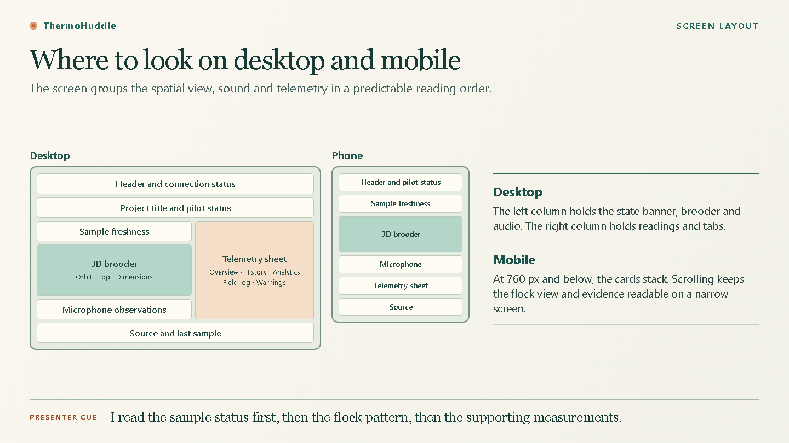

**What it shows**

Screen layout describes where information lives. The top bar contains the connection status and scenario access. On a wide screen, the observation column and telemetry sheet can be consulted together. The sheet provides Overview, History, Analytics, Field log and Warnings. The footer reports data-source information. A narrow screen places the same sections in a vertical sequence so a user can read them without fitting two small columns side by side.

**What to point at**

Trace the desktop layout from status to the model and across to telemetry. Follow the same sections down the phone layout.

**Speaking script**

> Now let’s look at where the information is placed. On desktop, I start at the connection and sample status. That tells me whether the rest of the screen is worth interpreting. My eye then moves down the left side to the brooder and the sound panel. On the right I can check the numbers and switch between Overview, History, Analytics, Field log and Warnings. That arrangement lets me compare a pattern with its supporting readings at the same time. On a phone, those sections stack vertically. I use the same reading order, but scroll down for the evidence.

## Dashboard

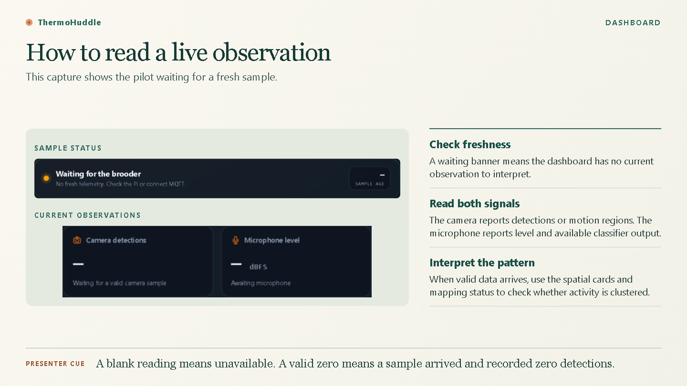

**What it shows**

The dashboard combines the latest evidence in one place. Freshness comes first. The pilot uses a 30-second freshness window for the observation sample. Nearest-neighbor distance describes spacing, and max-cell fraction reports the share in the busiest region of the 4 × 4 grid. As a worked example, six out of ten detections in one cell gives 60%. That shows concentration. Calibration, sample quality and further measurements are needed to interpret its cause. A microphone label describes the sound sample and cannot establish flock health by itself.

**What to point at**

Point to Waiting for the brooder, then the two empty signal cards. Contrast those dashes with a valid detection count of zero.

**Speaking script**

> Finally, this is how I would read the dashboard in front of an audience. Right now it says Waiting for the brooder, and both signal cards show dashes. That means a fresh sample is unavailable. If the camera sent a valid sample with zero detections, the dashboard could display zero. Once readings are available, I look at the floor pattern together with the microphone and the calibration status. For example, if six of ten detections fell in one grid cell, that cell would hold sixty percent of the detections. I could report that the activity was concentrated there. I would need more evidence before saying why. That is what our pilot contributes: a way to see a pattern, check the evidence behind it, and explain what the system actually observed.

## How the full design relates to the pilot

The use-case figure selects the observation workflow. If the panel asks about an item in the original system diagram, use this mapping.

| Original use case | How to explain it |
|---|---|
| UC-01, UC-02 and UC-03 | Observe floor distribution and sound, then inspect corner mapping. UC-01A and UC-02A are the supporting vision and audio functions. |
| UC-04 and UC-10 | Display available environmental telemetry and relay a limited remote snapshot. Label missing sensor channels as unavailable. |
| UC-05, UC-06 and UC-07 | The broader design covers hazard acknowledgement, safety arbitration and bounded thermal adjustment. The demo can illustrate an alert. A simulated alert does not validate a physical cutoff or closed-loop controller. |
| UC-08 and UC-09 | Review history and evaluation summaries, or run scenarios. Thermal trends and CSV export are restricted in the observation-only live pilot. |

## Questions you can rehearse

**Why are there dashes in the live dashboard?**

Check the sample age and connection. A dash means the pilot has no usable value for that signal. A valid camera sample with no detections can report 0. If the Pi or its cloud bridge is offline during the defense, show the waiting screen, then explicitly select a demo.

**How do the four corner markers help?**

Each marker has a known ID and floor position. The system can match the four camera-image positions to the four floor positions and compute a perspective transform, also called a homography. If mapping is missing or partial, treat the displayed positions as approximate and avoid claims about physical spacing.

**What does the microphone tell us?**

dBFS is a digital level relative to the maximum recordable signal. A value closer to zero is louder on that recording scale. Peak frequency is measured in hertz. A classifier label summarizes the audio window. It takes independently verified observations to connect a sound pattern to flock health.

**Which spatial measurements should I explain?**

Nearest-neighbor distance asks how close each detection is to its closest neighbor. Max-cell fraction asks what share falls in the busiest region. Entropy describes how evenly detections occupy the grid. Clark–Evans R compares spacing with what a random distribution would predict. Use one measure and a concrete example in the talk.

**Does the lamp in the 3D scene control physical hardware?**

The lamp illustrates the enclosure design. Live mode in this pilot is observation-only. The separate control design describes bounded temperature adjustments and safety checks. Demonstrating a lamp fault or a thermal response on the dashboard exercises the simulation.

**What is the difference between UI, screen layout and dashboard?**

UI means the actions a person can take, such as choosing Cold or rotating the model. Screen layout means where those actions and readings appear on desktop and phone. Dashboard means how the operator brings the readings together to interpret one situation.

# Additional demonstration figures

## Dashboard in light theme

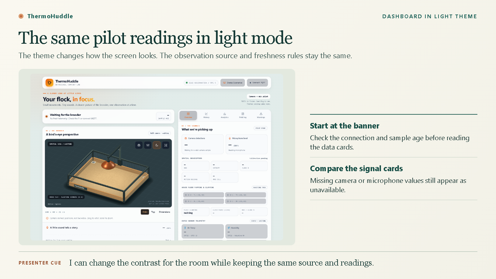

**What it shows**

This is the same observation interface in its light theme. It can be easier to show on a bright projector.

**What to point at**

Point to the state banner and the signal cards.

**Speaking script**

> If the dark screen is hard to read on the projector, I can switch to the light theme. I still begin with the same status banner, and the two signal cards carry the same meaning.

## Cold scenario

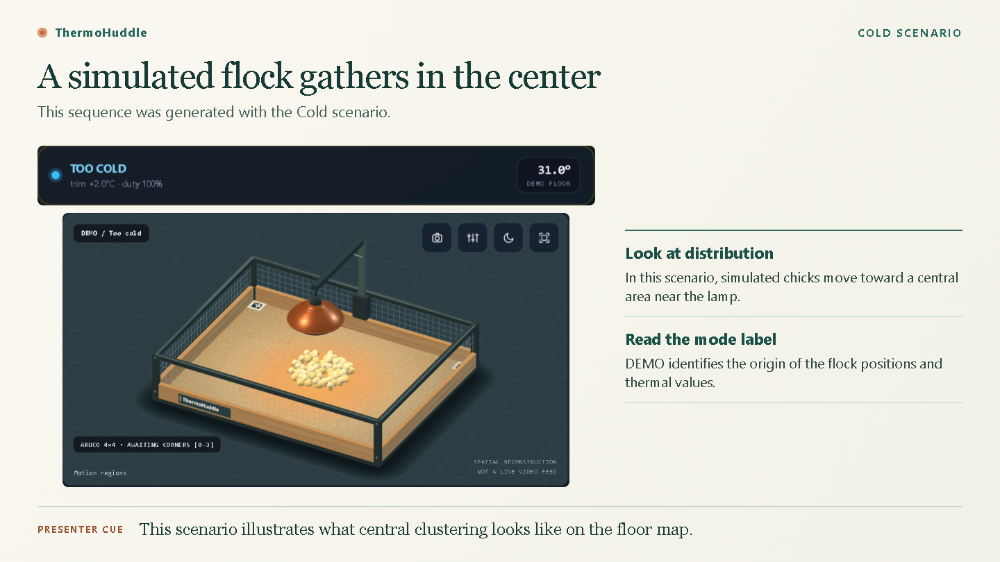

**What it shows**

The scenario provides a recognizable spatial pattern for teaching. A similar pattern in a live observation would require corroboration before drawing conclusions about temperature.

**What to point at**

Trace the cluster, then show the DEMO label.

**Speaking script**

> In Cold, the simulated chicks move toward the central area. This makes the distribution easy to see. If the real flock showed a similar pattern, we would check the mapping and other measurements before assigning a cause.

## Crowding scenario

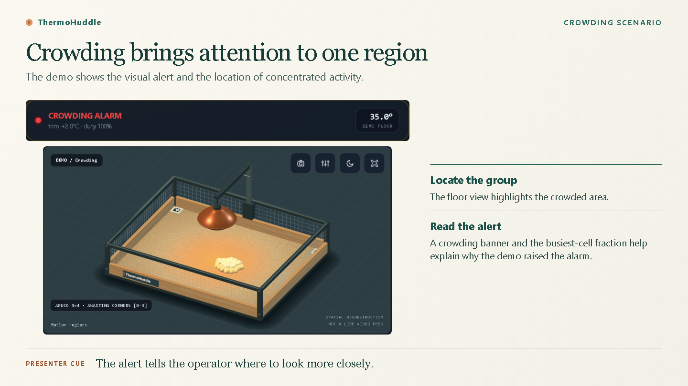

**What it shows**

A large share of the simulated flock occupying one cell over repeated windows can trigger the crowding condition. The alert provides a location to inspect.

**What to point at**

Compare the alarm banner with the highlighted area on the floor.

**Speaking script**

> In Crowding, notice how many simulated chicks occupy the same region. Look at the alarm and then at the floor. Together they show both the warning and where the operator would start looking.

## History

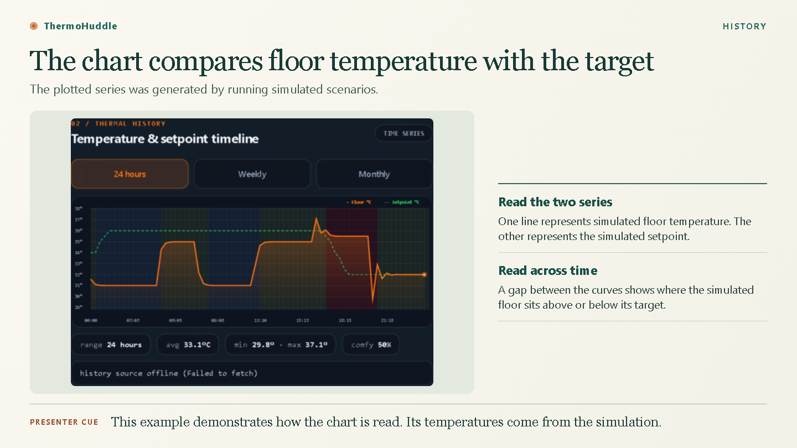

**What it shows**

The chart is useful for showing how a time series differs from a single reading. The live camera and microphone pilot withholds thermal history when measured floor data is unavailable.

**What to point at**

Trace the two curves and indicate a period where they separate.

**Speaking script**

> The history panel lets us compare the simulated floor temperature with its target over time. Where the lines separate, we can see the direction of the difference. The live pilot keeps measured thermal history unavailable until it has the appropriate evidence.

## Analytics

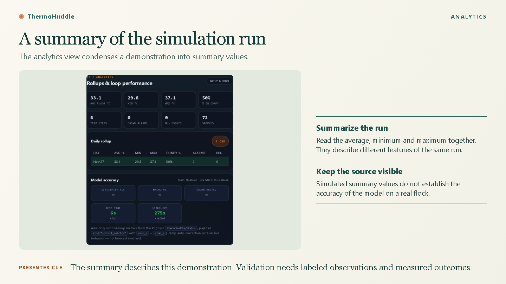

**What it shows**

Summary cards compress a sequence of samples. Model-performance and thermal-control claims require a separate validation study. The live pilot withholds unvalidated thermal summaries and disables thermal CSV export.

**What to point at**

Indicate the average and range at the top of Analytics.

**Speaking script**

> Analytics summarizes the run so we can discuss its average and range without reading every point in the chart. These numbers come from the demonstration. A real performance claim would require labeled observations and a comparison against measured outcomes.

## Mobile interface

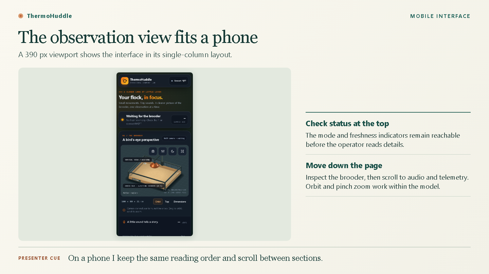

**What it shows**

The capture uses the actual mobile viewport. Lower panels continue below the visible part of the phone screen.

**What to point at**

Point to the state banner, then to the brooder beneath it.

**Speaking script**

> This is the same dashboard at phone width. I can read the state, inspect the brooder and then scroll to the supporting readings. The single-column layout gives the model enough room for touch interaction.

## Project references

[Current dashboard](https://tanjames121.github.io/thermohuddle/) · [Detailed use-case design](use-case-diagram.html) · [Detailed layout blueprint](screen-layout-diagram.html) · [Pilot behavior](../../pilot.js) · [Three.js model](../../brooder-scene.js)
